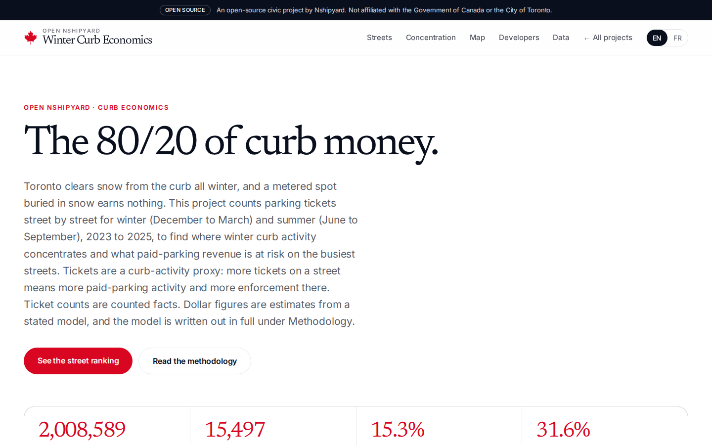

# Toronto streets by winter parking revenue at risk

**10 streets take 15% of Toronto's winter parking tickets. Danforth Ave carries the most meter revenue at risk, $19K to $517K per winter.**

Toronto clears snow from its streets all winter, and a metered spot buried in snow earns nothing. The city knows what one storm costs: in February 2025, snow removal closed 47% of the Toronto Parking Authority on-street inventory and the city recorded 371,000 fewer parking transactions (Toronto Parking Authority 2026 Operating Budget report). What the city does not publish is where, street by street, that loss lands. There is no public stall-level inventory of Toronto street parking: SenSen holds a closed street-parking mapping contract with the Parking Authority, and the asset registry is not open. The enforcement data is open. This project works from the open side: it counts every parking ticket in the City of Toronto open data for 2023 to 2025 by street, splits the counts into winter (December to March) and summer (June to September), measures how concentrated each season is, and estimates winter revenue at risk for the streets where an estimate can be defended.

An open-source civic project. Not affiliated with the Government of Canada or the City of Toronto.

## Screenshots




## What the data shows

Findings computed from the 2023 to 2025 slice by `scripts/build_winter.py`. Ticket counts and shares are counted facts. Dollar figures are estimates from the model described under Methodology, and are labelled as estimates everywhere they appear.

- Winter carries 2,008,589 tickets over 364 days (5,518 a day). Summer carries 2,197,757 over 366 days (6,005 a day). Winter is quieter overall, but its activity sits on fewer streets.
- The 10 busiest streets hold 15.3% of all winter tickets, against 12.5% for the 10 busiest summer streets. The top 50 hold 31.6% of winter against 28.6% of summer. By the top 200 the gap narrows (53.2% winter, 52.0% summer), and at the top 500 and top 1,000 summer edges ahead. Winter's extra concentration is a top-of-the-table effect: the first few hundred streets matter more in winter than in summer. The Gini coefficient across all streets is nearly the same in both seasons (0.896 winter, 0.902 summer), because it averages the whole distribution, including the long tail where summer is slightly more concentrated.
- Yonge St is the busiest winter street at 56,769 tickets, 2.83% of the citywide winter total, ahead of Queen St W (41,482) and Keele St (37,291). 15,497 streets appear in the data; 12,184 have at least one winter ticket.
- The revenue ranking is not the ticket ranking. Danforth Ave is fourth by winter tickets (34,908) but first by estimated revenue at risk, because 23,877 of its winter tickets are meter tickets, the most of any street: an estimated $19,137 to $516,712 per winter season. Keele St is third by tickets and near the bottom of the revenue table at $486 to $13,114, because only 606 of its 37,291 winter tickets are meter tickets. Ticket volume measures enforcement and parking activity together; meter tickets are the part that maps to paid street parking revenue.
- Some busy streets get no dollar figure at all, on purpose. Roehampton Ave (5,408 winter tickets, 10 winter meter tickets) and Thorncliffe Park Dr (5,275 winter tickets, 0 winter meter tickets) are marked not estimable: their tickets are permit and prohibition enforcement, not meter activity, and the model does not convert them into dollars. 368 of 15,497 streets clear the estimability threshold.
- At ward level, winter activity concentrates downtown. Ward 10 (Spadina-Fort York) holds 246,856 address-matched winter tickets, 14.1% of the citywide address-matched total, followed by Ward 11 (University-Rosedale, 231,034) and Ward 13 (Toronto Centre, 182,009). The three downtown wards together hold 37.7% of address-matched winter tickets.
- One anchor for scale: a lost on-street space forgoes about $3,224 a year ($67.7 million of on-street revenue over 21,000 spaces, Parking Authority 2026 budget). Yonge St's estimated winter revenue at risk, $11,225 to $303,076 per winter season, is roughly 3 to 94 space-years of revenue on one street. Repainting a stall costs about $6; the money at risk in winter is the paid hours, not the paint.

## Files

- `data/street_season.csv` - one row per street (15,497 rows): winter tickets, summer tickets, winter meter tickets, share of city winter tickets, share of the street's own counted tickets that fell in winter, estimated revenue at risk per winter (low and high) or blank with `estimable = no`, and a method tag (`rate-band-model-v1` or `not-estimable-low-meter-sample`). Also served at `/data/street_season.csv`.
- `data/ward_season.csv` - one row per ward (25 rows): winter and summer tickets for address-matched tickets only, plus shares. Also served at `/data/ward_season.csv`.
- `data/concentration.json` - top-10 and top-50 shares for both seasons, Gini coefficients, a cumulative rank table (top 1 to top 1,000), and Lorenz curve points for both seasons. Also served at `/data/concentration.json`.
- `data/summary.json` - slice definition, totals, model constants as computed from the data, and the top street.
- `data/app_data.json` - compact bundle consumed by the app (summary, concentration, top 300 streets, wards).
- `scripts/build_winter.py` - the data build. Reads the raw ticket CSVs and the Address Points file from the sibling reference project (`~/workspace/toronto-parking-tickets-geocoded/data/`), plus ward boundaries from `~/workspace/toronto-geo-concordances/data/raw/wards25.geojson`. Paths are command-line arguments (`--source`, `--geo`). The script header documents every rule in this README.
- `public/geo/wards25_simple.geojson` - ward boundaries simplified for the SVG map (Douglas-Peucker, tolerance 0.0004 degrees, coordinates rounded to 5 decimals; produced by the build script).

## Methodology

1. Slice: City of Toronto open data, Parking Tickets, calendar years 2023 to 2025, retrieved 2026-10-08: 6,454,695 tickets. Winter is the months December, January, February, March (364 days in the slice). Summer is June, July, August, September (366 days). The two seasons differ by two days, so raw counts are compared directly and the day counts are stated wherever totals appear.
2. Street for each ticket: the ticket field `location2` holds either a house number plus street (642 KING ST W) or a street alone (LOWTHER AVE, used at intersections). The script strips any leading house number (including range addresses such as 123-456 and unit letters), normalizes street-type spellings with the same table the reference project uses (STREET becomes ST, AVENUE becomes AVE), and counts the ticket to that street. Street-only tickets are included: a ticket at an intersection still records activity on that street. This differs from the reference project, which counted only address-matched tickets, so street totals here are higher than the reference project's totals for the same street. 6,454,115 tickets yielded a street; 579 had an empty location and 1 row had an unparseable date (a truncated line in the 2025 file).
3. Tickets are a proxy, and the proxy has known flaws. A street can rank high because many drivers park there, because officers patrol there often, or both; the data cannot separate the two. Tickets for parking on private property (infraction code 3, the single largest code citywide) record lot enforcement, not street parking use, and they are included in street ticket counts. That is why the dollar estimates are built only from meter tickets, never from total tickets.
4. Revenue model, inputs that are facts: the Toronto Parking Authority 2026 Operating Budget report (https://toronto.ca/legdocs/mmis/2025/pa/bgrd/backgroundfile-260741.pdf) gives on-street revenue of $67.7 million over 21,000 spaces, off-street revenue of $97.4 million, and a 2025 forecast of $177.3 million on 32.4 million transactions, a blended $5.47 per transaction. Dividing on-street revenue by the blended rate gives about 12.37 million on-street transactions a year. One lost on-street space forgoes $67.7 million divided by 21,000, about $3,224 a year. The February 2025 storm figures (47% of on-street inventory closed, 371,000 fewer transactions) are from the same report. On-street hourly rates of $1.50 to $6.75 by zone are the Parking Authority rate bands. The repainting cost of about $6 per stall and the June 1 to October 31 repainting season (two coats) are from the City of Toronto pavement markings page (toronto.ca).
5. Revenue model, input measured from this dataset: meter tickets are infraction codes 207, 312, 313 and 314 (parking machine fee not paid, machine not used, fail to activate machine, not within paid period). The script counts 1,157,660 of them across 2023 to 2025 and divides the on-street transactions above by meter tickets per year (385,887). The result, 32.1, is the number of paid on-street sessions standing behind each meter ticket, computed in `data/summary.json`. Every street estimate scales from that street's own winter meter tickets using that one conversion.
6. Revenue model, stated assumptions (judgment calls, set wide on purpose): a paid session lasts 1.0 to 2.0 hours (the posted maximum stay at most Toronto meters is 3 hours); snow makes 5% to 15% of winter meter-hours unusable on an average street over a full winter (in February 2025 one storm closed 47% of on-street inventory, but a full-winter average is far below a storm peak); the hourly rate spans the full rate band, $1.50 to $6.75. Per street and per winter season: low estimate = winter meter tickets per year, times 32.1 sessions per meter ticket, times 1.0 hour, times 5%, times $1.50. High estimate = the same with 2.0 hours, 15%, and $6.75. The band is wide because the inputs are uncertain; a narrower band would claim precision the data does not have.
7. Estimability rule: a street needs at least 100 winter meter tickets over the three winters before the conversion is applied. Below that, the dataset reports the street's activity share and marks revenue as not estimable. 368 streets qualify.
8. Ward map: tickets with a house number were matched to the City's Address Points file on house number plus normalized street, and the address point supplies the ward. Street-only tickets and addresses the file does not contain cannot be placed, so ward totals are lower than street totals: 1,751,862 of 2,008,589 winter tickets (87.2%) and 1,895,399 of 2,197,757 summer tickets (86.2%) are address-matched.
9. Verification: the pipeline totals were spot-checked against the raw CSVs with an independently written counter for four streets. Winter counts agreed within 0.3% on all four (Yonge St 56,687 independent against 56,769 pipeline; Queen St W 41,420 against 41,482; Danforth Ave 34,815 against 34,908; Keele St 37,279 against 37,291). The small differences come from address forms the independent counter does not handle (range addresses and unit letters). The ward summer total produced by this pipeline (1,895,399) matches the reference project's geocoded monthly totals for June to September exactly, which cross-checks the address matching. One raw file (the 2025 yearly file) contains non-UTF-8 bytes and is read as cp1252 by fallback in the script.

## Confidence and limits

- Fact: ticket counts, season totals, shares, concentration measures, ward counts. These are counts of a complete administrative file, subject only to the street-extraction rules above.
- Estimate: every dollar figure. Each one depends on the sessions-per-meter-ticket conversion (measured citywide, applied per street), the paid-hours range, the snow-loss range, and the rate band. A street whose true rate is at the top of the band and whose snow loss is heavy sits near its high estimate; a low-rate residential meter street sits below its low estimate if its meters charge less than $1.50, which cannot happen under the current band, or if its sessions run shorter than 1 hour, which can. Read the bands as the size of the activity at risk, not as a forecast of lost revenue.
- Inference: that clearing snow first on the highest-ranked streets protects the most revenue. The ranking shows where ticketed activity concentrates; it does not show plow routes, stall counts per street, or demand during storms.
- Not available at any confidence: stall counts per street (no public inventory exists; SenSen's street parking mapping for the Parking Authority is closed), actual revenue per street (the Parking Authority does not publish it), and payment outcomes for individual tickets.

## API

REST under `/api/v1/curb/`: `summary`, `streets` (ranked by winter tickets; `q` filters by name, `limit` caps rows), `wards` (optional `ward` parameter), `concentration`, `search`. OpenAPI 3.1 at `/api/openapi.json`. MCP at `POST /mcp` with tools `curb_street_stats`, `curb_ward_stats`, `curb_concentration`.

## Run it

```
python3 scripts/build_winter.py \
  --source ~/workspace/toronto-parking-tickets-geocoded/data \
  --geo ~/workspace/toronto-geo-concordances/data/raw/wards25.geojson
npm install
npm run build
npm run start
```

## Author

**Richardson Dackam** - [X (@richardsondx)](https://x.com/richardsondx) · [GitHub](https://github.com/richardsondx)
